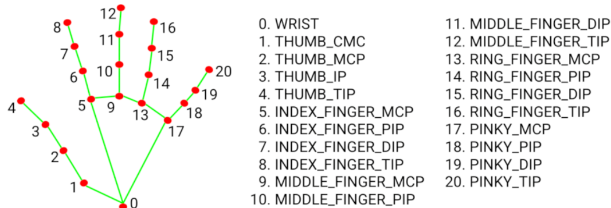

<h1 align="center"> Sign Language </h1>

## 👋 Introduction

In this project, We will create a model trained on largest dataset of its kind, release specially for [Google - American Sign Language Fingerspelling Recognition Competition](https://www.kaggle.com/competitions/asl-fingerspelling/data). **Tensorflow** are framework that mainly using in this project. 

One thing you need to know that, We make this project **just for learning**, so that this model performance can not be better than another SOTA models.

We also deploy it in local host so that it limited of client using and and we will not discuss it more here. 

## 👤 Contributors
**I would like to express my sincere thanks to the these wonderful people who have contributed to this project with me:**

- Hoa D. (Leader)
- Tung S. (contributor)
- Binh P. (contributor)
- Hai V. (contributor)
- Lam N. (contributor)
- Duc P. (contributor)

## 📝 Work Flow

### A. Data
#### Raw Data
`path` - The path to the landmark file.

`file_id` - A unique identifier for the data file.

`participant_id` - A unique identifier for the data contributor.

`sequence_id` - A unique identifier for the landmark sequence. Each data file may contain many sequences.

`phrase` - The labels for the landmark sequence. The train and test datasets contain randomly generated addresses, phone numbers, and urls derived from components of real addresses/phone numbers/urls. Any overlap with real addresses, phone numbers, or urls is purely accidental. The supplemental dataset consists of fingerspelled sentences. *Note that some of the urls include adult content*. The intent of this competition is to support the Deaf and Hard of Hearing community in engaging with technology on an equal footing with other adults.

Each path will is a parquet file containing a pandas dataframe with the shape of *(162699,1630)*, 162699 is length of list of short sentences and 1630 columns are 1630 landmarks.

This 1630 landmark extract in image by using [MediaPipe](https://google.github.io/mediapipe/solutions/hands.html) and [OpenCV](https://opencv.org/). We only using landmarks from 2 hands and lip.

#### EDA 
#### Preprocessing

### B. Model

### C. Web

