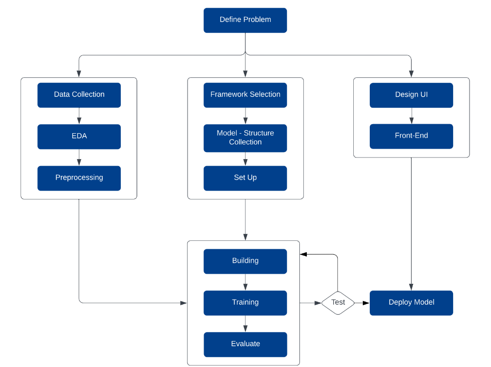
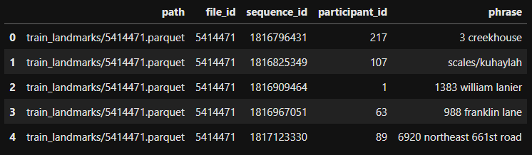
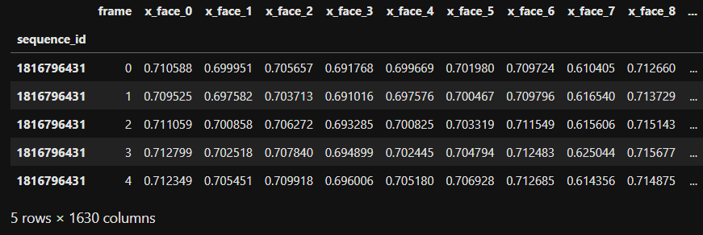
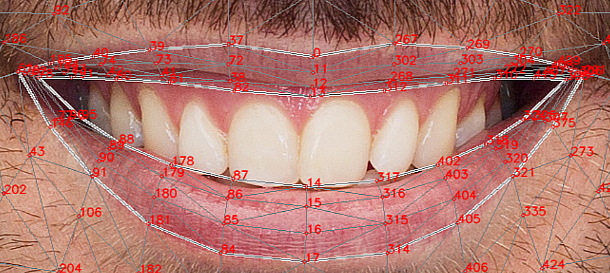

<h1 align="center"> Sign Language </h1>

## 👋 Introduction

In this project, We will create a model trained on largest dataset of its kind, release specially for [Google - American Sign Language Fingerspelling Recognition Competition](https://www.kaggle.com/competitions/asl-fingerspelling/data). **Tensorflow** are framework that mainly using in this project. 

One thing you need to know that, We make this project **just for learning**, so that this model performance can not be better than another SOTA models.

We also deploy it in local host so that it limited of client using and and we will not discuss it more here. 

## 👤 Contributors
**I would like to express my sincere thanks to the these wonderful people who have contributed to this project with me:**

- Hoa D. (Leader)
- Tung S. (contributor)
- Binh P. (contributor)
- Hai V. (contributor)
- Lam N. (contributor)
- Duc P. (contributor)

## 📝 Work Flow

### A. Data
1. #### Raw Data
`path` - The path to the landmark file.

`file_id` - A unique identifier for the data file.

`participant_id` - A unique identifier for the data contributor.

`sequence_id` - A unique identifier for the landmark sequence. Each data file may contain many sequences.

`phrase` - The labels for the landmark sequence. The train and test datasets contain randomly generated addresses, phone numbers, and urls derived from components of real addresses/phone numbers/urls.

2. #### EDA 
<!-- A parquet/landmarks file containing a pandas dataframe with the shape of *(162699,1630)*, with 162699 is a length of list of short sentences and 1630 columns are 1630 landmarks.

*Example:*

*This image is a part of training data*

*This image is a part of landmarks dataframe in parquet file* -->

There are 1630 landmarks in orginal data, but we just use 21 landmarks from each hand and 80 landmarks from lip in this project.

*This image illustrates the 21 landmarks on the hand*

source: [MediaPipe](https://google.github.io/mediapipe/solutions/hands.html)

*This image illustrates the 80 landmarks on the lip*

source: [MediaPipe](https://google.github.io/mediapipe/solutions/face_mesh.html)

3. #### Preprocessing

### B. Model

### C. Web